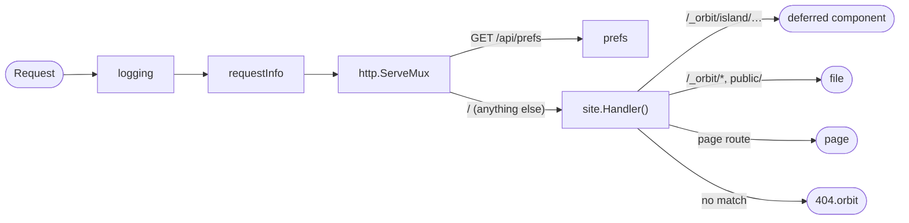

# Middleware and locals

Orbit has one middleware model, plain `net/http` middleware in `cmd/server/main.go`, and it hands request data to your pages through a typed `Locals` struct.

```go file=src/locals/locals.go
// Package locals declares the request-scoped data that middleware hands to pages.
package locals

type Locals struct {
	RequestID string
	Theme     string // "light" or "dark"
}
```

```go file=cmd/server/main.go
package main

import (
	"crypto/rand"
	"encoding/json"
	"log"
	"net/http"
	"time"

	"github.com/bertrandkhe/orbit"

	"example.com/blog/orbit_gen/app"
	"example.com/blog/src/locals"
)

func main() {
	site := app.New()

	mux := http.NewServeMux()
	mux.HandleFunc("GET /api/prefs", prefs)
	mux.Handle("/", site.Handler())

	// logging runs first, then requestInfo, then the mux and Orbit.
	if err := orbit.ListenAndServe(logging(requestInfo(mux))); err != nil {
		log.Fatal(err)
	}
}

// requestInfo gives each request an ID and reads the theme cookie.
func requestInfo(next http.Handler) http.Handler {
	return http.HandlerFunc(func(w http.ResponseWriter, r *http.Request) {
		r, l := orbit.EnsureLocals[locals.Locals](r)
		l.RequestID = rand.Text()
		l.Theme = "light"
		if c, err := r.Cookie("theme"); err == nil && c.Value == "dark" {
			l.Theme = "dark"
		}
		w.Header().Set("X-Request-ID", l.RequestID)
		next.ServeHTTP(w, r)
	})
}

// logging logs each request with its status, duration and request ID.
func logging(next http.Handler) http.Handler {
	return http.HandlerFunc(func(w http.ResponseWriter, r *http.Request) {
		r, l := orbit.EnsureLocals[locals.Locals](r)
		rec := &statusRecorder{ResponseWriter: w, status: http.StatusOK}
		start := time.Now()
		next.ServeHTTP(rec, r)
		log.Printf("%s %s %d %s id=%s", r.Method, r.URL.Path, rec.status, time.Since(start), l.RequestID)
	})
}

// statusRecorder remembers the status code a handler wrote.
type statusRecorder struct {
	http.ResponseWriter
	status int
}

func (s *statusRecorder) WriteHeader(code int) {
	s.status = code
	s.ResponseWriter.WriteHeader(code)
}

func (s *statusRecorder) Unwrap() http.ResponseWriter { return s.ResponseWriter }

// prefs is a regular handler that reads the same typed locals.
func prefs(w http.ResponseWriter, r *http.Request) {
	l := orbit.LocalsFromRequest[locals.Locals](r)
	if l == nil {
		http.Error(w, "locals not set: wrap this handler with requestInfo", http.StatusInternalServerError)
		return
	}
	w.Header().Set("Content-Type", "application/json")
	if err := json.NewEncoder(w).Encode(map[string]string{"theme": l.Theme}); err != nil {
		log.Printf("prefs: %v", err)
	}
}
```

```orbit file=src/pages/account.orbit
---
import Layout "../layouts/Base.orbit"
---
<Layout title="Your account">
  <h1>Your account</h1>
  <p>Theme: {locals.Theme}</p>
  <p>Request ID: <code>{locals.RequestID}</code></p>
</Layout>
```

`curl -b theme=dark localhost:4321/account` shows `dark` and a fresh request ID, and the log line for that request carries the same ID. Pages read `locals.Theme` fully type-checked: a typo such as `locals.Them` fails `orbit build` at that line of the `.orbit` file, and your editor completes `locals.`.

## Writing middleware

A middleware is a `func(http.Handler) http.Handler`, the standard Go shape. It can work in three places:

- **Before `next.ServeHTTP`**: read the request, set response headers (`requestInfo` sets `X-Request-ID`), and fill in locals.
- **Instead of `next.ServeHTTP`**: write a response itself and stop. See [Short-circuit responses](#short-circuit-responses).
- **After `next.ServeHTTP`**: look at what was written, through a wrapping `http.ResponseWriter` (`logging` records the status). See [Rewrite responses](#rewrite-responses).

There's no Orbit-specific middleware type. Anything from the Go ecosystem (CORS, gzip, rate limits, sessions) plugs in the same way.

## Where middleware goes

Where you put a middleware relative to Orbit decides what it sees:

- **Outside Orbit**, wrapping `site.Middleware` or the mux that leads to `site.Handler()`, as above: it sees every request, pages, island requests, assets, `public/` files and your own handlers alike. Middleware that sets locals for pages must go here, so it runs before Orbit.
- **After Orbit**, inside it (`site.Middleware(cors(mux))`): it only sees requests Orbit didn't handle. Locals it sets never reach a page.

Middleware listed first runs first: in `logging(requestInfo(mux))`, `logging` sees the request before `requestInfo`, and sees the response after it. See [Server](server.md#choosing-precedence) for where the mux and Orbit go.

Outer middleware also runs before Orbit's trailing-slash redirect, so it can see `/account/` as well as `/account`. Compare paths with that in mind (see [Routing](routing.md#trailing-slashes)).

## The request flow

With the `main.go` above, every request takes this path:



Inside `site.Handler()`, Orbit picks up the `*locals.Locals` that `EnsureLocals` attached to the request, and the page, its components and `404.orbit` all render with it. Responses come back out through `requestInfo` and `logging`.

**Island requests** take the same path. A component rendered with `server:defer` is fetched by the browser in its own request to `/_orbit/island/…`, after the page has loaded. That request goes through `logging` and `requestInfo` like any other, so the deferred component sees the visitor's cookies and its own `locals`, with a new request ID. Nothing from the page's request carries over. See [Lazy loading](lazy-loading.md).

## Typed locals

Locals carry request-scoped data, such as a request ID or the visitor's theme, from your middleware to your pages and handlers. They're a struct you declare, so every use is type-checked.

### Declare the struct

Put `type Locals struct` in the Go package `src/locals` (package `locals`), as in `src/locals/locals.go` above. Orbit finds it by name. Without one, `locals` in pages is an `*orbit.NoLocals`, an empty struct.

### Set locals from middleware

Every middleware that sets fields starts with the same line:

```go
r, l := orbit.EnsureLocals[locals.Locals](r)
```

`EnsureLocals` returns the `*locals.Locals` already attached to the request, with `r` unchanged. If there's none, it attaches a new zero one and returns the new request. So the first middleware in the chain creates the value, and every later one gets the same pointer back. In the example, `logging` creates it, `requestInfo` fills it in, and `logging` reads `l.RequestID` after `next.ServeHTTP` returns.

Pass the returned `r` on to `next.ServeHTTP`: the attached value travels in the request's context.

The three functions you call:

```go
func EnsureLocals[L any](r *http.Request) (*http.Request, *L) // in middleware: the attached *L, or a new one
func WithLocals[L any](r *http.Request, l *L) *http.Request    // attaches a value you built yourself
func LocalsFromRequest[L any](r *http.Request) *L             // in your handlers: the attached *L, or nil
```

- **`WithLocals`** attaches a `*L` you built elsewhere. If one is already attached, handlers further down see the new one, while middleware that ran earlier keeps its own pointer. Prefer `EnsureLocals`, so all middleware shares one value.
- **`LocalsFromRequest`** returns `nil` when no middleware attached any, rather than a detached zero value whose writes would be lost. Check for `nil` in handlers that might run without your middleware, as `prefs` does.

### Read locals in pages and components

Every page and component has an implicit `locals` of type `*locals.Locals`, the value your middleware attached. The layout that `account.orbit` uses reads it too:

```orbit file=src/layouts/Base.orbit
---
type Props struct {
    Title string
}
---
<!DOCTYPE html>
<html lang="en" data-theme={locals.Theme}>
  <head>
    <meta charset="utf-8">
    <title>{props.Title}</title>
  </head>
  <body>
    <slot />
  </body>
</html>
```

Components on a page share the page's instance, so a field set by middleware is the same everywhere in one render.

Pages never see `nil`: if no middleware attached locals (a request that bypasses your middleware, or a test), Orbit allocates a zero `Locals` lazily, the first time a page or component uses it, once per request.

Inside the frontmatter, the variable `locals` shadows the package name. Hoisted helpers that need the type import `example.com/blog/src/locals` as usual. See [Components](components.md).

## Short-circuit responses

A middleware short-circuits the usual `net/http` way: it writes a response and doesn't call `next`.

```go
// maintenance answers every request with a 503 while MAINTENANCE=1 is set.
func maintenance(next http.Handler) http.Handler {
	on := os.Getenv("MAINTENANCE") == "1"
	return http.HandlerFunc(func(w http.ResponseWriter, r *http.Request) {
		if on {
			w.Header().Set("Retry-After", "600")
			http.Error(w, "Back soon", http.StatusServiceUnavailable)
			return
		}
		next.ServeHTTP(w, r)
	})
}
```

A page short-circuits from its frontmatter by returning early. The template doesn't render:

| Return | Response |
|---|---|
| `return ctx.Redirect("/blog", http.StatusFound)` | the redirect |
| `return orbit.ErrNotFound` | your `404.orbit` page, status 404 |
| `return err` | a 500 |

See [Rendering](rendering.md#status-codes-and-errors) for status codes and errors.

## Rewrite responses

To change a response after the page has rendered, wrap the `http.ResponseWriter`, as you would for any Go handler. Orbit buffers every page and writes it once, with `Content-Length`, after injecting its `<link>` and `<script>` tags, so a wrapper always sees the complete, final HTML:

```go
// stampVersion replaces %VERSION% in HTML responses.
func stampVersion(next http.Handler) http.Handler {
	return http.HandlerFunc(func(w http.ResponseWriter, r *http.Request) {
		bw := &bufferedWriter{ResponseWriter: w, status: http.StatusOK}
		next.ServeHTTP(bw, r)
		body := bw.body.Bytes()
		if r.Method != http.MethodHead && strings.HasPrefix(w.Header().Get("Content-Type"), "text/html") {
			body = bytes.ReplaceAll(body, []byte("%VERSION%"), []byte(version))
			w.Header().Set("Content-Length", strconv.Itoa(len(body)))
		}
		w.WriteHeader(bw.status)
		w.Write(body)
	})
}

// bufferedWriter holds the status and body until the handler returns.
type bufferedWriter struct {
	http.ResponseWriter
	status int
	body   bytes.Buffer
}

func (b *bufferedWriter) WriteHeader(code int)        { b.status = code }
func (b *bufferedWriter) Write(p []byte) (int, error) { return b.body.Write(p) }
```

Headers the page set are already in `w.Header()` when `next.ServeHTTP` returns, because the wrapper shares the underlying header map. A body-rewriting wrapper holds the whole response in memory, so put it only around what needs it, not around streaming handlers. To only add headers, set them before calling `next`, as `requestInfo` does.

## The import rule

Every generated page and component imports `src/locals` (that's how `locals` gets its type). So `src/locals`, and anything it imports, must not import `example.com/blog/orbit_gen/app`: that would be an import cycle. Keep it a plain types package.

Orbit checks this before Go does and reports the import, for example:

```
src/locals/locals.go:4:8: src/locals can't import example.com/blog/orbit_gen/app: every page imports src/locals, so this is an import cycle
```

An indirect import is reported at the import in `src/locals` that leads to it, with the chain of packages. `orbit doctor` checks it too.

## See also

- [Server](server.md): where Orbit and your middleware sit in `main.go`
- [Rendering](rendering.md): redirects, `orbit.ErrNotFound` and errors from the frontmatter
- [Lazy loading](lazy-loading.md): island requests and your middleware
- [Components](components.md): `locals`, `ctx` and `props` in the frontmatter
- [Testing](testing.md): rendering with `orbittest.WithLocals`
