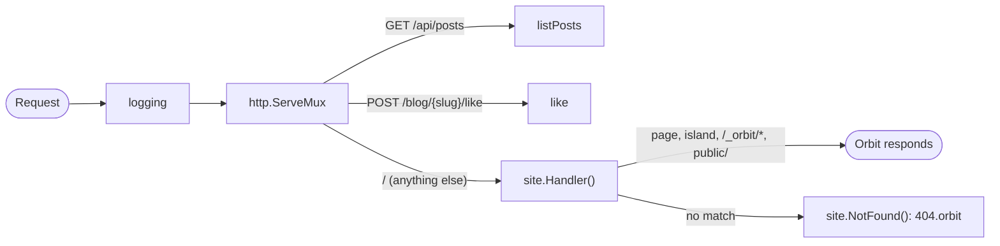
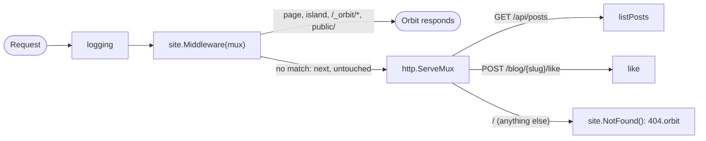

# Server

Orbit plugs into your Go server as a standard `net/http` middleware, and your own `cmd/server/main.go` decides where it sits.

```go file=cmd/server/main.go
package main

import (
	"encoding/json"
	"log"
	"net/http"
	"sync"
	"time"

	"github.com/orbit-z/orbit"

	"example.com/blog/internal/posts"
	"example.com/blog/orbit_gen/app"
	"example.com/blog/orbit_gen/decl/components/likebutton"
)

func main() {
	site := app.New() // generated from src/pages by orbit

	mux := http.NewServeMux()
	mux.HandleFunc("GET /api/posts", listPosts)
	mux.HandleFunc("POST /blog/{slug}/like", like)
	mux.Handle("/", site.Handler()) // everything else: pages, assets, islands, 404

	if err := orbit.ListenAndServe(logging(mux)); err != nil {
		log.Fatal(err)
	}
}

func listPosts(w http.ResponseWriter, r *http.Request) {
	all, err := posts.All()
	if err != nil {
		http.Error(w, err.Error(), http.StatusInternalServerError)
		return
	}
	w.Header().Set("Content-Type", "application/json")
	if err := json.NewEncoder(w).Encode(all); err != nil {
		log.Printf("listPosts: %v", err)
	}
}

var (
	mu    sync.Mutex
	likes = map[string]int{}
)

// like answers an htmx request with a freshly rendered LikeButton.
func like(w http.ResponseWriter, r *http.Request) {
	slug := r.PathValue("slug")
	if _, err := posts.Find(slug); err != nil {
		http.NotFound(w, r)
		return
	}
	mu.Lock()
	likes[slug]++
	n := likes[slug]
	mu.Unlock()

	props := likebutton.Props{Slug: slug, Likes: n}
	if err := orbit.RenderComponent(w, r, likebutton.Render, props); err != nil {
		http.Error(w, "render failed", http.StatusInternalServerError)
	}
}

func logging(next http.Handler) http.Handler {
	return http.HandlerFunc(func(w http.ResponseWriter, r *http.Request) {
		start := time.Now()
		next.ServeHTTP(w, r)
		log.Printf("%s %s %s", r.Method, r.URL.Path, time.Since(start))
	})
}
```

This is a complete server: two API routes, the blog's pages, and request logging around all of it. `orbit new` scaffolds a smaller version of this file, and it's yours to edit.

<details>
<summary>The other files this example uses: <code>internal/posts/posts.go</code> and <code>src/components/LikeButton.orbit</code></summary>

```go file=internal/posts/posts.go
// Package posts is a tiny in-memory post store for the examples.
package posts

import "errors"

// ErrNotFound is returned by Find for an unknown slug.
var ErrNotFound = errors.New("posts: not found")

type Post struct {
	Slug  string
	Title string
	Tags  []string
}

var all = []Post{
	{Slug: "hello", Title: "Hello, Orbit", Tags: []string{"news"}},
	{Slug: "routing", Title: "File-based routing", Tags: []string{"guides"}},
}

// All returns every post.
func All() ([]Post, error) { return all, nil }

// Find returns the post with the given slug, or ErrNotFound.
func Find(slug string) (Post, error) {
	for _, p := range all {
		if p.Slug == slug {
			return p, nil
		}
	}
	return Post{}, ErrNotFound
}
```

```orbit file=src/components/LikeButton.orbit
---
type Props struct {
    Slug  string
    Likes int
}
---
<button class="like" hx-post={"/blog/" + props.Slug + "/like"} hx-swap="outerHTML">
  ♥ {props.Likes}
</button>
<style>
  .like { border: 0; background: none; cursor: pointer }
</style>
```

</details>

## Orbit is `net/http` middleware

`app.New()` comes from the generated package `example.com/blog/orbit_gen/app` and returns an `*orbit.Site`. It gives you three handlers:

| Method | What it is |
|---|---|
| `site.Middleware(next http.Handler) http.Handler` | Serves what Orbit owns and passes everything else to `next` |
| `site.Handler() http.Handler` | `site.Middleware(site.NotFound())`: a complete handler that ends in your 404 page |
| `site.NotFound() http.Handler` | Renders `404.orbit` with status 404 |

`site.Middleware(next)` handles a request only if it matches something Orbit owns. It checks, in this order:

1. **The island endpoint** `/_orbit/island/…`, which renders `server:defer` components, for `GET`, `HEAD` and `POST`. See [The island endpoint](#the-island-endpoint).
2. **`/_orbit/*` assets and `public/` files**, for `GET` and `HEAD` only. Other methods go to `next`.
3. **Pages**, for every method. The page reads `ctx.Request.Method`.

Anything else goes to `next` **untouched**: Orbit writes no bytes, sets no headers and buffers nothing. See [Routing](routing.md#which-http-methods-orbit-handles) for the method rules, including the catch-all caveat.

Because `Middleware` is a plain `func(http.Handler) http.Handler`, it composes with any `net/http` code.

## The server entry: `cmd/server/main.go`

Orbit builds your server from the package in `cmd/server`, or the one `"server"` points to in `orbit.json` (see [Configuration](configuration.md)):

```json
{ "server": "./cmd/server" }
```

The same `main` runs in `orbit dev` and in production, so your routes and middleware behave the same way in both.

If the project has no server entry, Orbit generates a default one in `orbit_gen/cmd/server`. It's equivalent to:

```go
if err := orbit.ListenAndServe(app.New().Handler()); err != nil {
	log.Fatal(err)
}
```

`orbit new` always scaffolds `cmd/server/main.go`, so the composition is visible from day one.

`cmd/server` imports `orbit_gen/app`, which only exists after `orbit generate` (or `orbit build`/`orbit dev`). On a fresh clone, run `go tool orbit generate` before `go build` or `go vet`. See [Project structure](project-structure.md).

## Choosing precedence

When one of your routes and a page could both answer a URL, the order you compose them in decides who wins. There are two patterns.

### A) Custom routes first

Register Orbit as the mux's `/` pattern. In `http.ServeMux`, `/` is the least specific pattern, so every more specific route you register wins, and everything else goes to Orbit. This is the setup at the top of this page.

```go
mux.HandleFunc("GET /api/posts", listPosts)
mux.HandleFunc("POST /blog/{slug}/like", like)
mux.Handle("/", site.Handler())
h := logging(mux)
```



Pick this when your routes must never be shadowed by a page, for example an API under `/api/`. A route you register at the same path as a page replaces that page. Don't register routes under `/_orbit/`: that prefix belongs to Orbit.

### B) Pages first

Wrap your mux with `site.Middleware`. Orbit looks at each request first and falls back to your mux. Give the mux `site.NotFound()` as its catch-all, so unmatched URLs render `404.orbit` instead of the mux's plain-text 404.

```go
mux.HandleFunc("GET /api/posts", listPosts)
mux.HandleFunc("POST /blog/{slug}/like", like)
mux.Handle("/", site.NotFound()) // unmatched paths render 404.orbit
h := logging(site.Middleware(mux))
```



Pick this when pages should win, for example when a content team adds pages that may overlap with older handler paths. Things to watch:

- **Pages claim every method.** `POST /blog/hello/like` still reaches `like`, because `[slug]` matches a single segment and no page matches `/blog/hello/like`. But a page at the same path as one of your routes wins for `GET`, `POST` and everything else.
- **Catch-alls claim their whole prefix.** A `[...rest]` page answers every method under its prefix. Keep your handlers outside those prefixes.
- **Trailing slashes** are redirected only for page paths. A request for your `/api/items/` route reaches the mux untouched, unless `/api/items` is also a page.

## Wrapping with middleware

Where you put a middleware relative to Orbit decides what it sees:

- **Outside Orbit** (`logging(site.Middleware(mux))`, or `logging(mux)` in pattern A): it sees every request, pages, island requests and custom routes alike. Put logging, sessions, CORS, rate limiting and gzip here. Orbit never compresses responses itself.
- **After Orbit** (`site.Middleware(cors(mux))` in pattern B): it only sees the requests Orbit didn't handle.

Any ecosystem middleware works, because Orbit is a plain `http.Handler`.

To hand request data, such as a request ID or the visitor's theme, to your pages, set typed locals from a middleware outside Orbit with `orbit.EnsureLocals`. Pages read them as `locals.Theme`, and your handlers with `orbit.LocalsFromRequest`. See [Middleware and locals](middleware.md).

## The island endpoint

A component rendered with `server:defer` is sent as a placeholder, and the browser fetches its HTML afterwards from `/_orbit/island/<buildID>/<id>`. That endpoint lives inside `site.Middleware`, so:

- **It goes through your middleware.** An island request is an ordinary browser request: it passes through every middleware wrapped around Orbit, with its own cookies and its own `locals`. In pattern A it reaches Orbit through the mux's `/` catch-all.
- **Middleware placed after Orbit never sees it**, like pages.
- **CSRF middleware** that requires a token on `POST` blocks islands with large props, which are fetched with `POST`. Exempt `/_orbit/island/`, or use Go's `http.CrossOriginProtection`, which lets same-origin requests through.

See [Lazy loading](lazy-loading.md) for status codes, caching headers and the island key.

## Using chi, Gin or another router

You don't need a router library; Orbit itself depends only on the standard library. If you already use one, the same two patterns apply:

- **chi**: add Orbit as middleware with `r.Use(site.Middleware)` for pages first, or make it the fallback with `r.NotFound(site.Handler().ServeHTTP)` for custom routes first.
- **Gin**: wrap the handler with `gin.WrapH(site.Handler())`, for example as the engine's `NoRoute` handler, so Gin's routes take precedence.
- **Echo** and others: anything that accepts an `http.Handler` or a `func(http.Handler) http.Handler` works the same way.

These embeddings follow from Orbit being plain `net/http`, but they aren't covered by Orbit's own tests yet.

## Rendering components from handlers

`orbit.RenderComponent` renders any component as an HTML fragment from a regular handler. It's handy for htmx, which swaps server-rendered snippets into the page:

```go
func RenderComponent[P any](w http.ResponseWriter, r *http.Request,
    render func(*orbit.Ctx, *orbit.Writer, P, orbit.Slots) error, props P) error
```

The `like` handler at the top of this page uses it. The button's `hx-post` sends `POST /blog/hello/like`, and htmx replaces the button with the response:

```go
props := likebutton.Props{Slug: slug, Likes: n}
if err := orbit.RenderComponent(w, r, likebutton.Render, props); err != nil {
    http.Error(w, "render failed", http.StatusInternalServerError)
}
```

- **Import components** from their generated declaration package: `src/components/LikeButton.orbit` is `example.com/blog/orbit_gen/decl/components/likebutton`, with `Render` and `Props`.
- **Buffered, like a page**: the fragment is written with status 200, `Content-Type: text/html; charset=utf-8` and `Content-Length`. As in a page, the component can change the status with `ctx.SetStatus` and add headers with `ctx.Header()` (an htmx `HX-Trigger`, say, or its own `Content-Type`).
- **Errors are returned**: if rendering fails, nothing is written and the error is returned, so you can still send your own error response. That includes a panic in the component (returned as an error naming the `.orbit` line) and the `ctx.Redirect` and `orbit.ErrNotFound` errors, which only a page turns into a redirect or the 404 page.
- **No head injection**: a fragment has no `<head>`, so Orbit adds no `<link>` or `<script>` tags. The component's CSS and scripts load only on pages that already include the component, such as the post page rendering `<LikeButton slug={post.Slug} likes={0} />`. Its scoped styles then apply to the fragment too.
- **Locals**: the component's `locals` are the ones attached to `r` by your middleware with `orbit.EnsureLocals`.
- **No site URL**: `ctx.Site` is nil in a fragment, since `RenderComponent` doesn't know your `Site`.
- **No islands from fragments**: a `server:defer` placeholder inside a fragment loads only if the page it lands in already has deferred components of its own.

Rendering a full page, with its assets, from a custom handler is not yet supported.

## Listening: `ListenAndServe` and `Addr`

`orbit.ListenAndServe(h)` starts an HTTP server for `h` on `orbit.Addr()` and shuts down gracefully on `SIGINT` or `SIGTERM`. It reads no command-line flags, so it never clashes with your own. After a graceful shutdown it returns `nil`, so `if err := orbit.ListenAndServe(h); err != nil { log.Fatal(err) }` exits cleanly on Ctrl-C and only logs real failures, such as a port that's already taken. (Don't write `log.Fatal(orbit.ListenAndServe(h))`: `log.Fatal` exits with status 1 even when the error is nil.) Its settings:

- `ReadHeaderTimeout` of 10 seconds and `IdleTimeout` of 120 seconds;
- no `ReadTimeout` or `WriteTimeout`, so slow uploads and your own streaming handlers keep working;
- on shutdown, up to 5 seconds for in-flight requests to finish. If requests are still running after that, it closes their connections and returns `orbit: shutdown: context deadline exceeded` instead of `nil`. A second Ctrl-C during the shutdown stops the process at once.

`orbit.Addr()` picks the address from the environment:

1. `$ORBIT_ADDR` if set, for example `127.0.0.1:8080`;
2. otherwise `":" + $PORT`, as set by many hosting platforms;
3. otherwise `:4321`.

If you'd rather run your own `http.Server`, use `orbit.Addr()` for its address so `orbit dev` can still reach it:

```go
srv := &http.Server{
	Addr:              orbit.Addr(),
	Handler:           logging(mux),
	ReadHeaderTimeout: 10 * time.Second,
}

ctx, stop := signal.NotifyContext(context.Background(), os.Interrupt, syscall.SIGTERM)
defer stop()
done := make(chan struct{})
go func() {
	defer close(done)
	<-ctx.Done()
	shutdown, cancel := context.WithTimeout(context.Background(), 5*time.Second)
	defer cancel()
	srv.Shutdown(shutdown)
}()
if err := srv.ListenAndServe(); err != http.ErrServerClosed {
	log.Fatal(err)
}
<-done // wait for in-flight requests
```

## Running under `orbit dev`

`orbit dev` builds your server entry and runs it on a random localhost port, behind its own proxy on `localhost:4321` that adds live reload. It tells your app what to do through environment variables, which `app.New()` and `orbit.Addr()` read for you:

| Variable | Set by `orbit dev` to | Effect |
|---|---|---|
| `ORBIT_DEV` | `1` | Asset URLs come from the dev manifest, so CSS/JS edits need no Go rebuild; render errors show the dev overlay |
| `ORBIT_ADDR` | `127.0.0.1:<port>` | Where your server must listen; `orbit.Addr()` returns it |
| `ORBIT_STATIC` | `.orbit/dev` | Where `/_orbit/*` assets are served from |
| `ORBIT_PUBLIC` | `public` | `public/` is served directly, without a copy step |
| `ORBIT_KEY` | a key generated once per `orbit dev` session | Deferred components on open pages keep loading across app restarts; a key you set yourself wins |

Pages render per request in dev exactly as in production; only where assets come from and how errors are shown differ.

In production, `ORBIT_STATIC` is optional (the default is `dist/client` next to the binary) and `ORBIT_PUBLIC` is unset, because `public/` was copied into the static directory at build time. You can also set the static directory in code with `app.New(orbit.WithStaticDir("/srv/blog"))`; `--embed` builds use `orbit.WithStaticFS` automatically. See [Deploy](deploy.md).

The `ORBIT_STATIC` variable takes precedence over `WithStaticDir`, as it does over the files of an `--embed` build, so `orbit dev` keeps working if you hard-code a directory.

To stay dev-compatible:

- **Listen on `orbit.Addr()`**, directly or through `orbit.ListenAndServe`. A server that listens on a fixed port can't be reached by the dev proxy.
- **Shut down on `SIGINT`**. On every Go rebuild, `orbit dev` sends `SIGINT`, waits up to 5 seconds for a graceful shutdown, then kills the process and starts the new build. `ListenAndServe` handles this for you.
- **Build the site with `app.New()`**, so it picks up the `ORBIT_*` variables.

See [Dev server](dev-server.md) for the rest of what `orbit dev` does.

## See also

- [Middleware and locals](middleware.md): net/http middleware and typed `Locals`
- [Routing](routing.md): which methods and paths Orbit claims
- [Rendering](rendering.md): the request lifecycle and `dist/server`
- [Lazy loading](lazy-loading.md): `server:defer` and the island endpoint
- [Deploy](deploy.md): running `dist/server`, `--embed` and Docker
- [Runtime API](reference/runtime-api.md): the `orbit` package
